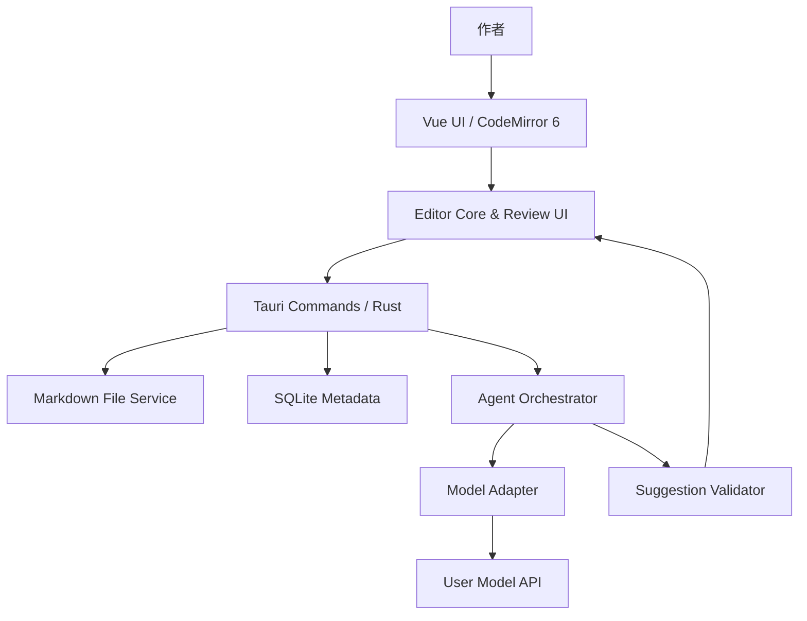

# 文屿 Vesrio｜开发计划书与技术实施规范

> 版本：v1.1｜日期：2026-10-22｜输入：`Vesrio-01-Product-Concept.md`｜执行清单：`Vesrio-03-Task-Breakdown.md`
>
> v1.1 变更：新增 V0.2 跨平台独立里程碑，V0.1 范围与验收不变。

## 1. 开发目标与边界

交付 **Windows 11 x64 首发、单用户、本地优先** 的 Markdown 桌面编辑器：能可靠打开/保存 Markdown，支持基本富文本式实时阅读、源码模式、选区 AI 建议、局部 Diff、人工接受/拒绝、基础 Agent 对话和项目风格卡。

首版不做账号、云同步、多人协作、自动研究、跨文档 RAG、自动发布、自进化、多 Agent、复杂 DOCX 往返。源码仓库独立于 Silyn；未来通过接口集成其记忆/反思能力。

交付物：可运行源码、锁定依赖、安装包、自动测试、Markdown 黄金测试语料、API/迁移文档、使用说明、已知问题、回滚说明。

## 2. 建议架构



| 层 | 推荐方案 | 核心责任 |
| --- | --- | --- |
| 桌面容器 | Tauri 2 + Rust | OS 文件访问、跨层命令、安全与安装 |
| UI | Vue 3 + TypeScript + Vite | 布局、快捷键、状态、错误/进度反馈 |
| 文本编辑 | CodeMirror 6 | 选区、事务、撤销/重做、装饰、语法反馈 |
| Markdown 解析 | CommonMark/GFM 兼容解析器 | 标题/列表/表格/围栏等结构识别，未知语法保持原文 |
| 元数据 | SQLite + 迁移 | 项目、会话、建议、风格、快照索引 |
| 模型访问 | Rust HTTP adapter | OpenAI-compatible、流式响应、取消、错误归一化 |
| 秘钥 | Windows Credential Manager/OS Keychain | 不在普通 JSON/SQLite/日志中明文保存 API key |
| 工程 | pnpm + Cargo | 依赖锁定、CI、单元/集成/E2E |

前端不直接持有 API key，不直接保存文件。模型不获得文件写入工具。所有实际正文更改只能通过 Editor Core 的受限事务执行。

### 2.1 建议目录

```text
vesrio/
  AGENTS.md
  docs/{prd.md,development-plan.md,wbs.md,adr/}
  src/
    app/
    features/{editor,inline-ai,agent,revisions,settings}/
    components/
  src-tauri/
    src/{commands,document,agent,provider,suggestion,storage,security}/
    migrations/
  tests/{fixtures/markdown,e2e,performance}/
  scripts/
```

## 3. 必须冻结的技术决策（ADR）

**ADR-001：Markdown 为正文真源。** `.md` 文件保存作者正文；聊天、建议、风格、快照放在独立应用数据目录。未接受的 AI 建议不写入原文，不向 Markdown 注入私有标记。无编辑时保存不得无故格式化全文。

**ADR-002：读写权限分离。** `readScope` 可包含选区、段落、章节、全文（作者明确授权）；`writeScope` 默认只能是选区。分析类任务 `writeScope = none`。Agent 有全文理解权限不等于有全文修改权限。

**ADR-003：AI 只产出候选。** 模型输出 `Suggestion`，经校验后在审阅 UI 呈现。仅用户点击接受时，Editor Core 生成事务；拒绝、取消、超时均不改变正文。接受过程可撤销，并在应用前建立快照。

**ADR-004：过期补丁不可直接套用。** 请求附带文档身份、内存修订号、选区 SHA-256 和前后上下文。模型生成期间用户继续修改时，旧建议标记 `stale` 并阻止直接应用，除非用户重新确认安全定位；首版以保守拒绝为准。

**ADR-005：编辑器与模型无耦合。** 模型接口以适配器封装，不依赖特定厂商的 JSON/schema 能力。所有模型文本作为不可信数据，不执行里面的工具调用或提示注入指令。

**ADR-006：不采用全文件无损风险高的转换链。** 优先编辑 Markdown 文本本身。若未来采用富文本 JSON 中间表示，必须通过未编辑区域字节保真与复杂语法往返测试，才可替换当前技术路线。

## 4. 核心实体与协议

### 4.1 数据对象

| 对象/表 | 关键字段 | 生命周期 |
| --- | --- | --- |
| Document | id, canonicalPath, encoding, lineEnding, diskHash, revisionId | 文件打开到关闭，持续跟踪 |
| Project | id, rootPath, styleProfileId | 本地文件夹级配置 |
| AgentRequest | id, documentId, intent, readScope, writeScope, baseRevision, status | 请求到成功/失败/取消 |
| Suggestion | id, requestId, anchor, originalText, candidateText, rationale, status | 创建到审阅结果 |
| Conversation/Message | projectId, documentId, role, content, sourceAnchors | 本地持久会话 |
| StyleProfile | id, projectId, version, rulesJson | 用户可编辑与版本化 |
| RevisionSnapshot | id, documentId, contentHash, snapshotPath, source, createdAt | 应用前与关键保存点 |

需要 schema 迁移与备份策略。API key 不进入任何上述表。

### 4.2 请求合同（示意）

```json
{
  "requestId": "uuid",
  "documentId": "uuid",
  "baseRevision": 37,
  "intent": "shorten_preserve_meaning",
  "readScope": "selection_with_paragraph_context",
  "writeScope": "selection_only",
  "anchor": {
    "fromUtf16": 218,
    "toUtf16": 284,
    "selectedTextSha256": "sha256-hex",
    "contextBefore": "...",
    "contextAfter": "..."
  },
  "selectedText": "原文",
  "instruction": "精简但不改变技术含义",
  "styleProfileVersion": 2
}
```

CodeMirror 的 `from/to` 属于 JavaScript UTF-16 偏移；Rust 处理 UTF-8 字节串时必须显式转换，禁止直接用 JS 偏移截取 UTF-8。测试需包含中文、emoji、组合字符、CRLF、空选区和段落末尾。

### 4.3 建议结果（示意）

```json
{
  "suggestionId": "uuid",
  "requestId": "uuid",
  "documentId": "uuid",
  "baseRevision": 37,
  "originalText": "原句",
  "candidateText": "建议句",
  "rationale": "删除冗余，保留原意",
  "status": "ready"
}
```

状态流转：`created → generating → ready → accepted/rejected/stale`，以及生成期间的 `canceled/failed`。应用为幂等操作，重复点击不能应用两遍。未完成的流式片段只作为预览，不可接受。

### 4.4 Agent 请求编排

1. 确认模型配置、当前意图和作用范围，并向用户展示将发送的上下文。
2. 组合稳定安全约束、即时指令、项目风格卡及授权的文档上下文。优先级：即时指令 > 项目风格 > 默认风格。
3. 调用 Provider，支持流、超时、取消、错误映射；取消不触发重试写入。
4. 将回复解析成候选字符串与简短理由；长度、结构、范围不安全时降级为只读建议。
5. 计算 Diff，校验 revision 与 hash，向 UI 发出 `ready` 或 `stale`。
6. 作者操作 `accept/reject`，后者不写正文；前者在一次 Editor 事务中生效，随后正常保存。

## 5. Markdown 与文件安全

- 保留 UTF-8 BOM、LF/CRLF、Front Matter、嵌套列表、代码围栏、GFM 表格、引用、相对图片、脚注、数学公式和未知 Markdown 扩展的原文；不支持富文本化的部分保留源码交互。
- 对非 UTF-8 文件显示编码提示并由用户决定是否转码，不自动不可逆转换。
- 自动保存只保存已接受/作者直接输入的状态；显示 `已保存/未保存/保存失败/外部冲突`，保存失败不得清除脏标记。
- 保存采用同目录临时文件、安全替换和错误处理，必须在 Windows 验证断电/权限不足/磁盘不足等异常路径。
- 外部变更采用磁盘 hash 检测。有未保存改动时给出重载、保留当前、另存副本，不默认覆盖。
- 快照要具备恢复入口、保留策略与容量提示；清理不得误删作者源文件。
- Diff 中的模型输出只按文本渲染，不直接注入 HTML。建议接受后可单步撤销。

## 6. UI 与交互方案

中央为可调窄栏正文，顶部为文档与保存状态，左侧可折叠文件树，右侧在「大纲 / Agent / 修订」标签间切换。选中文本后浮动调用 AI；建议卡就在选区附近，支持替换文本前后对照、两个候选、接受/拒绝和继续调整。

两个模式：

- **写作模式**：编辑区优先，隐藏大多数 AI 元素，不自动对每次键入调用模型。
- **审阅模式**：重点显示 AI 修改、诊断与待处理建议，可从问题跳回文档位置。

所有核心操作需要键盘路径；有生成中、失败、取消、应用成功的可见反馈。避免纯演示用的假按钮或未接线设置。

## 7. 开发里程碑与参考工期

按一名有经验的 Rust/Tauri + Vue 开发者规划 **12–16 周**，其中第 13–16 周是风险缓冲和真实试用。并行开发会缩短局部工作，但编辑器与补丁服务存在串行依赖。

| 阶段 | 周期 | 核心工作 | 退出条件 |
| --- | --- | --- | --- |
| S0 工程基线 | 第 1 周 | 仓库、脚手架、ADR、CI、黄金语料 | M0：开发环境可复现，基础检查运行成功 |
| S1 编辑器 | 第 2–4 周 | 文件、源码/实时视图、目录、保存、冲突、快照 | M1：离线文件往返保真，基本编辑体验可用 |
| S2 行内 AI | 第 5–7 周 | Provider、选区、建议、Diff、接受/拒绝、过期校验 | M2：完整「请求—审阅—应用」演示可复现 |
| S3 Agent + 风格 | 第 8–9 周 | 会话、引用回跳、风格卡、作用范围 | M3：针对段落提问且风格约束可控 |
| S4 测试与交付 | 第 10–12 周 | 性能、数据恢复、E2E、安装、文档 | M4：内测可安装，核心安全回归通过 |
| 缓冲/试用 | 第 13–16 周 | 真实写作试用、阻断问题修复 | 发布候选版与已知问题列表 |

若进度受限，优先延期复杂样式与部分高级候选交互；绝不能削减「无损保存」「过期补丁阻断」「快照恢复」。

### 7.1 V0.2 跨平台里程碑（独立）

V0.2 不扩展写作功能，只完成 Windows / macOS / Linux 平台化。任务、矩阵与门禁见 [v0.2-cross-platform-plan.md](./v0.2-cross-platform-plan.md)，架构决策见 [ADR-010](./adr/ADR-010-cross-platform-support.md)（Accepted）。V0.1 的范围、工期与验收保持不变。

| 阶段 | 参考周期 | 核心工作 | 退出条件 |
| --- | --- | --- | --- |
| S5 平台决策与基线 | 第 1～1.5 周 | 支持矩阵、ADR-010、平台耦合审计、CI 骨架 | G0：范围冻结；三平台可编译 |
| S6 数据安全 | 第 2～4 周 | 分平台凭据、Unix 原子保存、退出保护、路径边界 | G2：凭据与保存语义可验证 |
| S7 构建与桌面集成 | 第 5～6 周 | 打包目标、macOS 签名公证、Linux 桌面集成 | G3：三平台可安装/启动 |
| S8 体验与验证 | 第 7～9 周 | 快捷键/标题栏/字体、CI 矩阵、E2E、实机验收 | G4/G5：体验与发行门禁通过 |
| S9 发布准备 | 第 9～10 周 | 文档、安全检查、校验和、内测 | G6：可发布候选 |

参考工期 8～10 周（1 人），并行可压缩到 5～7 周。PRD 5.5 原有的 V0.2 SHOULD 功能顺延为 V0.3 候选，需负责人确认。

## 8. 测试与验收策略

| 层级 | 必须覆盖 |
| --- | --- |
| 单元测试 | UTF-16/UTF-8 映射、选区 hash、Markdown 范围识别、Diff、幂等状态机 |
| 集成测试 | Editor ↔ Tauri ↔ SQLite ↔ Provider，任务取消、超时与数据库迁移 |
| E2E | 打开、编辑、保存、请求建议、拒绝、接受、撤销、风格配置、重启与恢复 |
| 故障演练 | 文件外部改动、模型断网、API 500、磁盘写失败、崩溃与 10 MB 大文件 |
| 兼容验证 | V0.1：Windows 11 x64；Windows 10 作为独立验证项与支持矩阵记录。V0.2：macOS 13+、Ubuntu 22.04/24.04 LTS x64（见跨平台计划） |

黄金语料至少 20 份，覆盖中文长文本、emoji、CRLF、BOM、Front Matter、GFM 表格、代码围栏、数学公式、脚注、链接与图片、空文档、长段落。无编辑打开/保存不得改变原文；局部编辑不得无故触碰其它区域。

V0.1 必须演示以下场景：

1. 离线创建/编辑/保存/重开，内容不变。
2. 对中文段落发出精简请求，展示 Diff，拒绝不写入，接受能撤销。
3. 生成期间编辑原文，旧建议不可套用。
4. 项目风格卡进入新请求；Agent 讨论和定位到原文。
5. 保存错误与外部冲突提示，能恢复编辑状态。
6. 在干净 Windows 环境安装运行，配置模型但可选择不启用 AI。

## 9. 研发执行规范

### Definition of Ready

任务有编号、输入、依赖、负责模块、验收条件、测试方式及预计工作量；未明确的架构争议先写 ADR 再开发。

### Definition of Done

1. 功能实际接线，满足任务验收，异常路径有清晰 UI。
2. 修改包含相关测试；`cargo fmt/check/clippy/test`、前端 typecheck/lint/test 及可用 E2E 检查通过。
3. 不损坏文件保真、撤销、读写权限与隐私边界。
4. 文档、迁移、已知限制与手工验证步骤同步更新。
5. 任务 ID 写入提交或 PR，说明修改范围、测试结果与回退方式。

禁止 Coding Agent 在未经负责人确认时：扩大功能范围、替换锁定 ADR、删除黄金测试、自动推送生产更新、对私密文档调用外部服务、执行破坏性清理。

## 10. 交付与发布门禁

- P0 需求全部通过；P1 缺项必须明确披露并确认是否阻断发行。
- E2E 核心用户旅程与数据安全回归通过。
- API key 不进入日志、JSON 和可导出内容；第三方许可和隐私说明完成。
- 安装、升级、卸载和迁移均验证；卸载不得删除原始 Markdown 文件。
- 安装包含版本号、校验和、变更日志、已知问题、恢复说明。
- V0.2 跨平台发布按 [V0.2 计划](./v0.2-cross-platform-plan.md) 的 G0～G6 门禁执行；未在目标平台实机验证不得称“通过”。

**执行顺序以 `Vesrio-03-Task-Breakdown.md` 的依赖为准。起手任务为 `VES-001`；并在完成基本脚手架后尽早证明 Markdown 无损回环（PoC）。**
